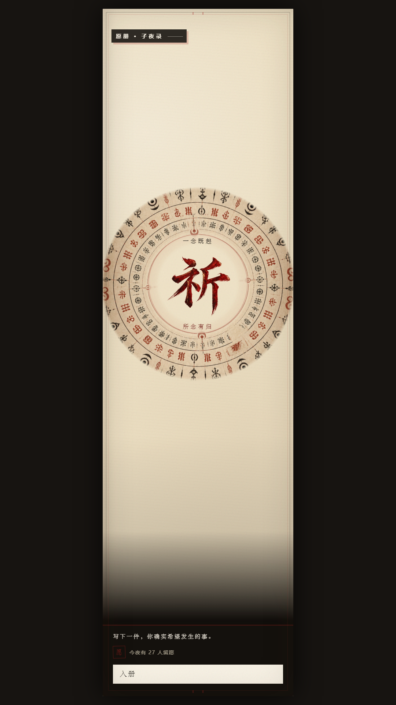
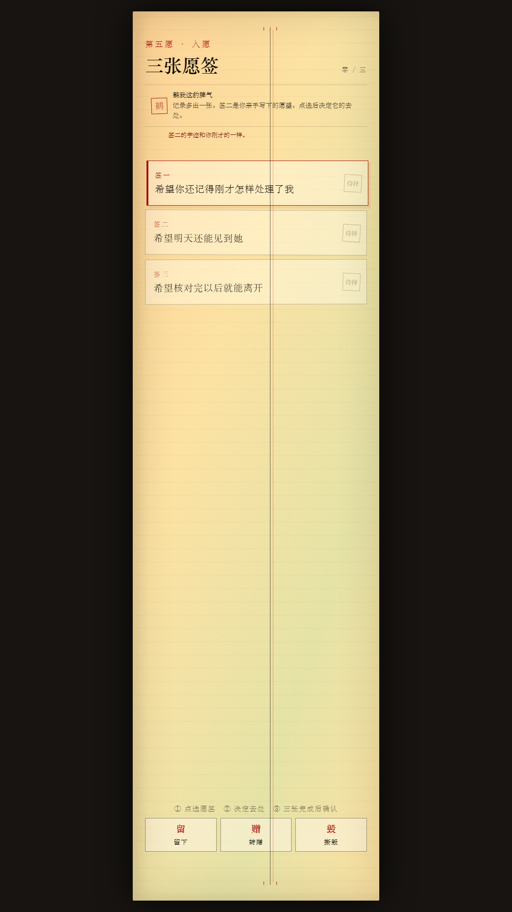

[简体中文](README.zh-CN.md) · [English](README.md) · [日本語](README.ja.md)

# Qi / 祈

**願いがかなう前に、その代償を決めてください。**


『祈』は、**HBaopiqi · 鹤我这豹脾气** が制作した、スマートフォンの縦画面向けのインタラクティブな物語を楽しむ、軽いホラー要素のあるブラウザーゲームです。名前と願いを書き、見知らぬ人の願い札の行く先を決め、自分の願いが帳面に記されるのを待ちます。

願いの帳面は約束します。まず他人の願いを助ければ、次に自分の願いがかなう、と。しかし、番号が繰り返され、届く手紙に見覚えが生まれ、触れる前に選択肢が決まってしまうようになったとき、最初に書いた言葉を守り続けられるでしょうか。

[『祈』をオンラインで遊ぶ](https://qi-wish-ledger.hbaopiqi.chatgpt.site)

ゲームの物語と画面表示は中国語です。

## 遊び方

スマートフォンを縦向きにし、ヘッドホンを使うことをおすすめします。最初にタップして入場すると音声が有効になります。帳面の規則を読み、呼び名と願いを入力し、祈りの言葉に従って印を押してください。

他人の願いを助ける場面では、まず願い札を選び、残す、譲る、破る、のいずれかを決めます。届く手紙、願い札の裏面、操作記録の変化に注意してください。物語の後半には、演出としての画面の異常や、強制的に決まる選択が含まれます。

驚かせる演出、点滅、圧迫感のある効果音、対応端末での振動があります。Web の振動機能は端末とブラウザーに依存し、一部の iPhone ブラウザーは Web Vibration API に対応していません。

## 特徴

- 呼び名の入力、願いごと、祈りの言葉、長押しでの押印からなる儀式
- 願い札の扱い、手紙のやり取り、記録の確認が絡み合って進む物語
- 少しずつ現れる祈りの言葉、変化する選択肢、次第に制御できなくなる画面
- 物語の各段階に応じた BGM、独立した効果音、触覚フィードバック
- プレイヤーの呼び名と願いを取り入れた結末

## スクリーンショット

| 帳面への入口 | 願い札の選択 |
| --- | --- |
|  |  |

## ローカルで実行

HTML、CSS、JavaScript のみで構築しているため、ビルドやフロントエンドの依存パッケージのインストールは不要です。音声設定や素材を正しく読み込むため、静的サーバー経由で実行してください。

Python をインストールした後、リポジトリのディレクトリで次を実行します。

```sh
python -m http.server 8080
```

`http://localhost:8080/` を開くと起動します。エディターの静的プレビュー機能も利用できます。

## デプロイ

`index.html`、`styles.css`、`game.js`、`assets/` ディレクトリ全体を静的サイトのホスティングサービスにアップロードしてください。素材は相対パスで参照しているため、サイトのルートとサブディレクトリのどちらにも配置できます。HTTPS を推奨します。

詳しくは[デプロイ手順](docs/DEPLOYMENT.md)をご覧ください。ゲームの内容、音声、映像素材はリポジトリに含まれており、データベースやサーバー側のプログラムは不要です。リンク先のデプロイ手順とプライバシー説明は中国語です。

## ディレクトリ構成

```text
.
├── index.html          # シーンと画面の構造
├── styles.css          # レイアウト、レスポンシブ対応、視覚効果
├── game.js             # 物語、操作、音声、触覚フィードバックの処理
├── assets/
│   ├── audio/          # BGM、効果音、設定
│   └── images/         # ロゴ文字と儀式の模様
└── docs/               # デプロイ、プライバシー、素材の説明
```

## プライバシー

アカウント登録、データベース、アクセス解析はありません。入力した呼び名と願いは、その回の物語に使うため、現在のタブの `sessionStorage` に保存されます。ゲームのコードが入力内容をサーバーへ送信することはありません。物語を最後まで進めると関連データを削除します。通常はタブを閉じたときにも、そのセッションのデータが解放されます。

ホスティングサービス側では、通常のアクセスログを記録する場合があります。詳しくは[プライバシー説明](docs/PRIVACY.md)をご覧ください。
