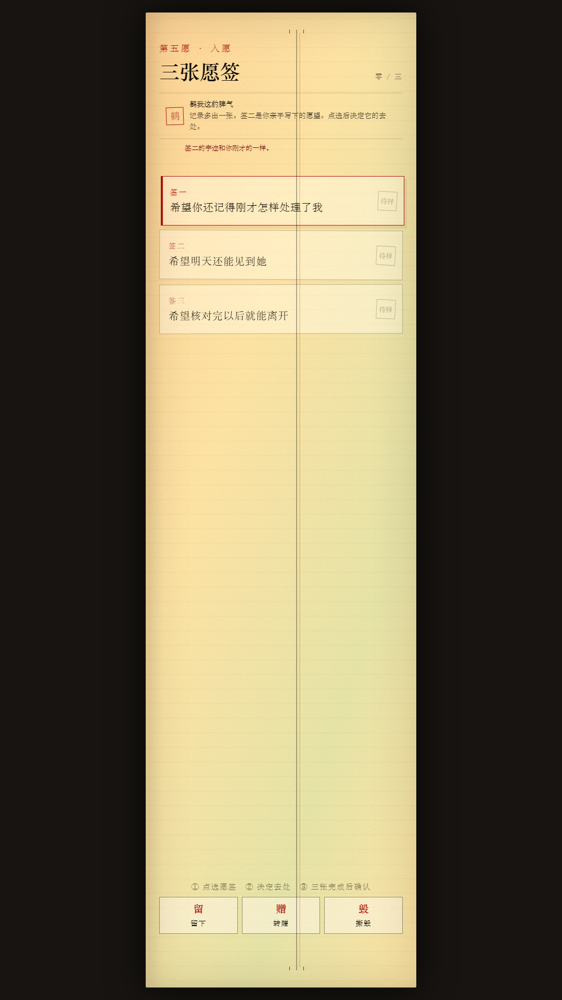

[简体中文](README.zh-CN.md) · [English](README.md) · [日本語](README.ja.md)

# Qi / 祈

**Before a wish comes true, decide what it will cost.**


*Qi* is an interactive narrative browser game with mild horror, designed for portrait play on a phone and created by **HBaopiqi · 鹤我这豹脾气**. Write down a name and a wish, decide what happens to strangers' wish slips, and wait for your own wish to enter the ledger.

The ledger promises: help others' wishes first, and your own will follow. But when numbers begin to repeat, letters feel familiar, and choices settle themselves before you touch them, can you still hold on to the words you wrote at the start?

[Play Qi online](https://qi-wish-ledger.hbaopiqi.chatgpt.site)

The game's narrative and interface are in Chinese.

## How to play

Use your phone in portrait orientation and wear headphones. On your first visit, tap to enter and enable sound. Read the ledger's rules, enter your name and wish, and follow the ritual text to press your seal.

When helping others with their wishes, select a wish slip, then choose to keep it, pass it on, or tear it up. Watch for changes in the letters, the backs of wish slips, and the activity log. Later sections include intentional interface disturbances and forced choices as part of the story.

The game contains scares, flashing effects, unsettling audio, and vibration feedback on supported devices. Web vibration depends on the device and browser; some iPhone browsers do not support the Web Vibration API.

## Features

- A ritual of entering a name, making a wish, reading an invocation, and pressing and holding to stamp a seal
- A story that unfolds through decisions about wish slips, incoming letters, and checking records
- Gradually revealed ritual text, changing choices, and an interface that increasingly slips out of your control
- Background music across multiple stages, separate sound effects, and haptic feedback
- An ending that incorporates the player's name and wish

## Screenshots

| Entering the ledger | Choosing a wish slip's fate |
| --- | --- |
|  |  |

## Run locally

The project uses plain HTML, CSS, and JavaScript. No build step or frontend dependency installation is required. Use a static server so that audio configuration and assets load correctly.

With Python installed, run this in the repository directory:

```sh
python -m http.server 8080
```

Then open `http://localhost:8080/`. An editor's static preview server also works.

## Deployment

Upload `index.html`, `styles.css`, `game.js`, and the complete `assets/` directory to a static hosting service. Assets use relative paths, so deployment works at either the site root or a subdirectory. HTTPS is recommended.

See the [deployment guide](docs/DEPLOYMENT.md) for details. The game content, audio, and visual assets are included in this repository; no database or server-side application is needed. The linked deployment and privacy documents are in Chinese.

## Directory structure

```text
.
├── index.html          # Scenes and interface structure
├── styles.css          # Layout, responsive styles, and visual effects
├── game.js             # Story, interaction, audio, and haptic logic
├── assets/
│   ├── audio/          # Background music, sound effects, and configuration
│   └── images/         # Wordmark and ritual patterns
└── docs/               # Deployment, privacy, and asset documentation
```

## Privacy

The game has no account registration, database, or analytics. The name and wish you enter are stored in the current tab's `sessionStorage` for this playthrough; the game code does not send these inputs to a server. Related data is cleared when the full story ends. Closing the tab also normally releases its session data.

The hosting provider may keep standard access logs. See the [privacy notice](docs/PRIVACY.md).
